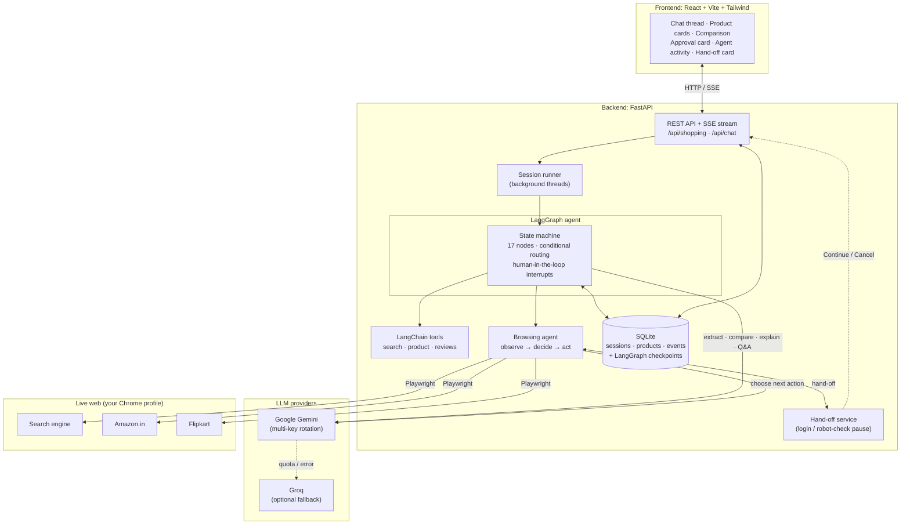
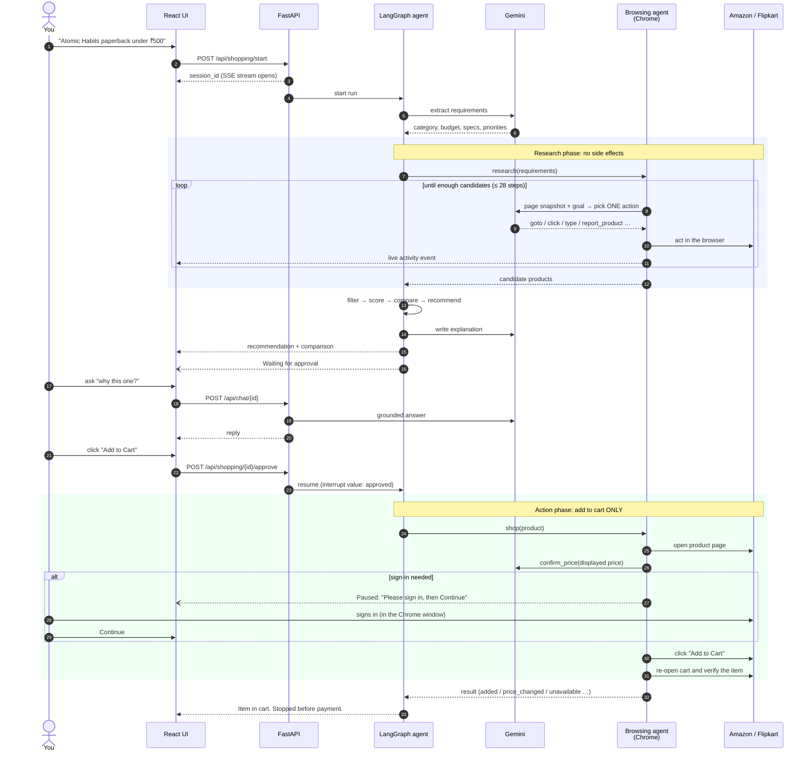
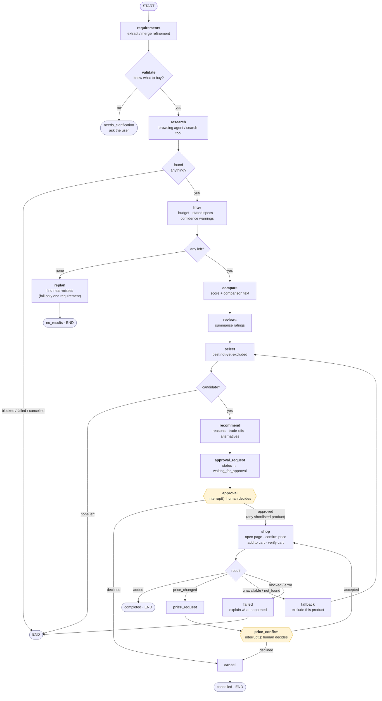
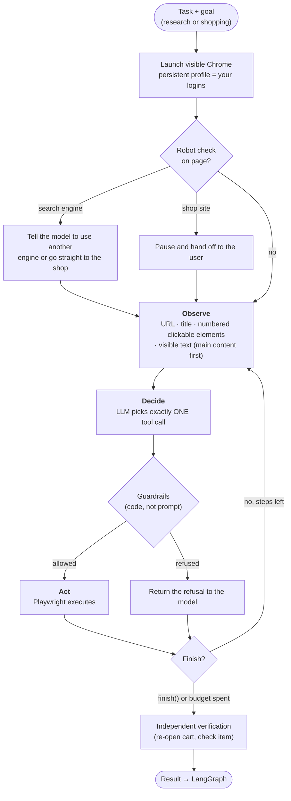
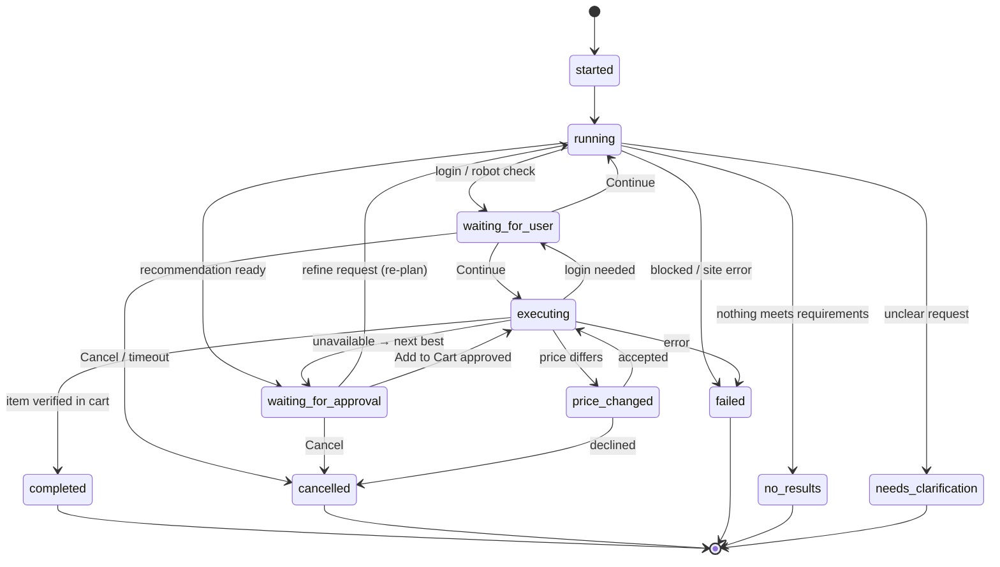

<div align="center">

# CartMind

### An autonomous AI shopping agent that researches products on the live web and adds the best match to your cart, with your approval at every action.


> Describe what you want in plain language. CartMind researches the options, recommends one, and, once you approve, adds it to your cart.
>
> **Gemini** reasons, **LangGraph** controls the workflow, **LangChain** connects the tools, **Playwright** operates the browser, and **you** approve every action.

</div>

---

## Table of contents

1. [What it does](#1-what-it-does)
2. [How it works](#2-how-it-works)
   - [System architecture](#21-system-architecture)
   - [End-to-end session flow](#22-end-to-end-session-flow)
   - [The LangGraph workflow](#23-the-langgraph-workflow)
   - [The browsing agent loop](#24-the-browsing-agent-loop)
   - [Session lifecycle](#25-session-lifecycle)
3. [Safety model](#3-safety-model)
4. [Operating modes](#4-operating-modes)
5. [Tech stack](#5-tech-stack)
6. [Project structure](#6-project-structure)
7. [Quick start](#7-quick-start)
8. [Configuration](#8-configuration)
9. [API reference](#9-api-reference)
10. [Testing](#10-testing)
11. [Failure handling](#11-failure-handling)
12. [Known limitations](#12-known-limitations)
13. [Responsible use](#13-responsible-use)

---

## 1. What it does

Traditional shopping means opening many tabs, comparing specs by hand, and clicking through every page.
A chatbot can recommend, but it does not **act**. CartMind does both:

| Step | What happens |
|---|---|
| **Understand** | Turns a natural-language request ("a laptop under ₹50k for coding, 16GB RAM") into structured requirements. Works for *any* product, not just electronics. |
| **Research** | An AI-driven **visible Chrome window** searches the web, opens Amazon.in / Flipkart, uses their search and filters, and records real candidates with real prices. |
| **Decide** | Filters out anything that breaks a mandatory requirement, scores the rest (spec fit, rating confidence, value, your priorities), compares them, and explains the pick with honest trade-offs. |
| **Ask** | Pauses and asks for **your explicit approval**. Nothing is added to a cart before you click. |
| **Act** | Opens the exact product page, re-verifies the price and stock, clicks **Add to Cart**, then re-opens the cart to prove the item is really there. |
| **Stop** | Never purchases and never pays. The flow always ends at the cart. |

You can chat throughout. Ask *"why this one?"* or *"is 16GB enough?"*, or change the request with *"raise the budget to 60k and prioritise battery"*, and the agent re-plans without starting over.

---

## 2. How it works

### 2.1 System architecture



### 2.2 End-to-end session flow



### 2.3 The LangGraph workflow

Every node is a plain Python function over a shared `ShoppingState`. Two nodes use LangGraph `interrupt()` to pause for a human; state is checkpointed to SQLite so a paused run survives a server restart.



**Conversational re-planning.** A chat message such as *"increase budget to 60k and prioritise performance"* is classified as a *refinement*, merged into the stored requirements, and the graph is restarted from `requirements` on a fresh checkpoint thread. Questions and "add it to cart" requests never restart anything.

### 2.4 The browsing agent loop

This loop is what makes the research phase agentic rather than scripted. There are no hard-coded selectors: the model reads each page and decides the next action.



**Tools the model can call**

| Tool | Purpose |
|---|---|
| `goto(url)` | Open an allow-listed URL |
| `click(id)` / `type_text(id, text, submit)` | Interact with a numbered element |
| `press_key` · `scroll` · `read_more(offset)` · `go_back` | Navigate and read |
| `ask_user(message)` | Pause for a login, OTP or robot check |
| `report_product(...)` | Record a verified candidate *(research only)* |
| `confirm_price(price)` | Report the displayed price, required before Add to Cart *(shopping only)* |
| `finish(outcome, summary)` | End the task |

### 2.5 Session lifecycle



---

## 3. Safety model

CartMind is designed so that the worst possible outcome is an extra item in a cart that you can remove. The rules below are enforced **in code**, so the model cannot bypass them, even if it misbehaves or is manipulated by page content.

| Risk | Protection |
|---|---|
| Accidental purchase | `Buy Now`, `Proceed to Buy`, `Checkout`, `Pay…`, `Place order`, `1-Click` clicks are **refused**; checkout / payment / `gp/buy` URLs are **refused**. The flow can only add to cart. |
| Acting without consent | The graph **pauses on a LangGraph interrupt**; only an explicit `approved: true` resumes it. Chat messages can only *open* the approval card. |
| Wrong price | Add to Cart is refused until the agent has called `confirm_price` with the displayed price. A mismatch pauses and asks you. |
| Credential handling | Password, card, CVV, OTP, UPI and sign-in-page fields **cannot be typed into**. You sign in yourself; the agent only ever sees a logged-in page. |
| CAPTCHA / bot checks | Never solved or bypassed. The agent hands off to you, or switches search engine / site. |
| Wandering | Only allow-listed domains open (`google`, `bing`, `duckduckgo`, `amazon.in/.com`, `flipkart.com`). Navigation that lands elsewhere is reversed. |
| Hallucinated success | "I added it" is **never trusted**. The cart page is re-opened and the item must be present. |
| Weak listings | Listings with few or no reviews, or a spec not stated in the title, are **shown with a warning and ranked lower**, never silently hidden. Only products over budget or contradicting a stated spec are removed. |
| Runaway agent | Hard step budgets (research 20, shopping 18) and a timeout on every human hand-off. |
| Leaked secrets | API keys live only on the backend. Your browser profile (`browser_profile/`) holds cookies and is **git-ignored**. |

---

## 4. Operating modes

Set with `SHOPPING_MODE`.

| Mode | What drives the browser | Needs LLM key | Best for |
|---|---|:---:|---|
| **`agent`** *(default)* | An LLM reads each page and chooses every action. Visible Chrome, persistent logins, human hand-off. | Yes | Real use |
| `live` | A fixed Amazon.in script (search + add to cart). | No | Quick checks without a key |
| `demo` | The built-in offline "CartMart" store. | No | Tests and demos with no internet |

> In `agent` mode, if no LLM key is configured the app falls back to `live` and says so in the activity log.

---

## 5. Tech stack

| Layer | Technology |
|---|---|
| **Frontend** | React 18, Vite, TypeScript, Tailwind CSS 3, React Router, Axios, Server-Sent Events |
| **Backend** | Python, FastAPI, Pydantic v2, SQLAlchemy, Uvicorn |
| **AI** | Google Gemini via `langchain-google-genai` (multi-key rotation), optional Groq fallback |
| **Orchestration** | LangGraph (state, conditional edges, `interrupt`, SQLite checkpoints), LangChain tools |
| **Browser automation** | Playwright with a persistent Chrome profile |
| **Storage** | SQLite (sessions, products, events, checkpoints) |
| **RAG (optional)** | Lightweight TF-IDF retriever over `knowledge_base/documents/` |
| **Testing** | pytest, real Chromium, scripted model for the agent loop |
| **Packaging** | Docker, docker-compose, nginx |

---

## 6. Project structure

```text
cartmind/
├── backend/
│   ├── app/
│   │   ├── main.py                 # FastAPI app factory
│   │   ├── config.py               # settings (env-driven)
│   │   ├── api/                    # shopping.py · chat.py · health.py
│   │   ├── agents/                 # ── the LangGraph brain ──
│   │   │   ├── graph.py            #   workflow wiring + SQLite checkpointer
│   │   │   ├── nodes.py            #   17 node functions + routers
│   │   │   ├── state.py            #   ShoppingState
│   │   │   ├── requirements.py     #   extraction (LLM + rules), validation, spec checks
│   │   │   ├── research.py         #   candidate search, filtering, confidence warnings
│   │   │   ├── comparison.py       #   deterministic scoring + comparison text
│   │   │   ├── recommendation.py   #   reasons, trade-offs, alternatives
│   │   │   ├── approval.py         #   human-in-the-loop payloads
│   │   │   ├── replanning.py       #   merge refinements, near-misses
│   │   │   └── shopping.py         #   dispatch to the right shopping tool
│   │   ├── tools/
│   │   │   ├── browser_agent.py    #   LLM-driven browsing agent and guardrails
│   │   │   ├── amazon_tool.py      #   scripted Amazon.in search / add-to-cart
│   │   │   ├── playwright_tool.py  #   demo-store automation
│   │   │   └── search_tool.py · product_tool.py · review_tool.py
│   │   ├── llm/                    # gemini.py · key_manager.py · prompts.py
│   │   ├── services/               # runner · sessions · chat_service · handoff
│   │   ├── rag/                    # embeddings · vectorstore · retriever
│   │   ├── store/                  # offline demo store (catalog + routes)
│   │   └── database/ · schemas/ · utils/
│   ├── login.py                    # one-time sign-in helper
│   ├── requirements.txt
│   └── Dockerfile
├── frontend/
│   ├── src/
│   │   ├── pages/                  # Home · ShoppingSession · History
│   │   ├── components/             # Chat · Composer · ProductCard · ProductComparison
│   │   │                           # AgentActivity · ApprovalDialog · UserAction · CartStatus · Shell
│   │   ├── hooks/                  # useShoppingSession · useAgentStream · useHealth
│   │   └── services/ · types/
│   ├── nginx.conf
│   └── Dockerfile
├── knowledge_base/documents/       # RAG source documents
├── tests/                          # 109 tests: agents · tools · api · playwright
├── docker-compose.yml
├── .env.example
└── README.md
```

---

## 7. Quick start

**Prerequisites:** Python 3.10+, Node 18+, Google Chrome, and a free Gemini API key from
[Google AI Studio](https://aistudio.google.com/apikey).

### 1. Configure

```bash
cp .env.example .env
# open .env and set:  GEMINI_API_KEY_1=your_key_here
```

### 2. Backend

```bash
cd backend
python -m venv .venv
source .venv/bin/activate            # Windows: .venv\Scripts\activate
pip install -r requirements.txt
playwright install chromium
```

### 3. Sign in to your shopping accounts (once)

```bash
python login.py
```

Chrome opens. Sign in to Amazon and Flipkart yourself, including any OTP or two-factor step, then close the window.
The session is stored in `backend/browser_profile/` and reused by the agent.
*(You can also skip this and sign in when the agent asks.)*

### 4. Run

```bash
# terminal 1: backend
cd backend && uvicorn app.main:app --port 8000 --timeout-graceful-shutdown 3

# terminal 2: frontend
cd frontend && npm install && npm run dev        # http://localhost:5173
```

Check `http://localhost:8000/api/health`: `"llm_configured": true` means the agent can think.

### 5. Run a sample request

> *Find the paperback of "Atomic Habits" by James Clear under ₹500 with a good rating. Show me the best option and add it to my cart.*

The Chrome window shows the agent working and the activity panel lists each step. Review the recommendation, click **Add to Cart**, then check your cart on the shop to confirm.

### Docker

```bash
docker compose up --build        # UI → http://localhost:3000   API docs → http://localhost:8000/docs
```

> Docker runs the browser headless and has no access to your desktop Chrome profile, so use it for `demo` / `live` modes or API work. For the full visible-browser agent, run locally as above.

---

## 8. Configuration

All settings are environment variables (see [`.env.example`](.env.example)).

| Variable | Default | Description |
|---|---|---|
| `GEMINI_API_KEY_1..3` | – | Gemini keys. Rotated automatically when one hits a quota limit. |
| `GEMINI_MODEL` | `gemini-3.8-flash` | Model used for reasoning and tool-calling. |
| `GROQ_API_KEY` / `GROQ_API_KEY_2` / `GROQ_MODEL` | – / – / `openai/gpt-oss-120b` | Optional fallback provider; the second key is used when the first is rate-limited. Check Groq's model list if a model is retired. |
| `SHOPPING_MODE` | `agent` | `agent` · `live` · `demo` (see [modes](#4-operating-modes)). |
| `AGENT_HEADLESS` | `false` | Keep `false` so you can see and assist the browser. |
| `AGENT_BROWSER_CHANNEL` | `chrome` | Use installed Chrome; falls back to bundled Chromium. |
| `BROWSER_PROFILE_DIR` | `backend/browser_profile` | Persistent profile (your logins). **Never commit.** |
| `AGENT_RESEARCH_STEPS` | `12` | Max model-driven steps while researching. |
| `AGENT_START` | `shop` | `shop` starts on the Amazon.in results page (fast); `google` starts from a web search. |
| `AGENT_MAX_PRODUCTS` | `5` | Candidates to collect before stopping, and the most that are shown. |
| `AGENT_SHOPPING_STEPS` | `18` | Max model-driven steps while adding to cart (fallback path). |
| `AGENT_FAST_PATH` | `true` | On Amazon.in, add to cart with the built-in routine first (no model calls); the AI agent is the fallback. |
| `USER_ACTION_TIMEOUT` | `900` | Seconds to wait for you on a login / robot check. |
| `AGENT_ALLOWED_DOMAINS` | google, bing, duckduckgo, amazon, flipkart | Domains the agent may open. |
| `DATABASE_URL` | `sqlite:///backend/cartmind.db` | Session database. |
| `CHECKPOINT_DB` | `backend/checkpoints.db` | LangGraph checkpoints. |
| `FRONTEND_URL` | `http://localhost:5173` | CORS origin. |
| `STORE_URL` | `http://127.0.0.1:8000/store` | Demo store base URL (`demo` mode). |
| `PLAYWRIGHT_HEADLESS` | `true` | Headless flag for `live` / `demo` modes. |
| `CAPTCHA_WAIT_SECONDS` | `120` | `live` mode: how long to wait for you to clear a robot check. |
| `SEARCH_API_KEY` | – | Reserved for a future search-API source. Currently unused. |

### LLM call budget

Free API tiers limit requests per day, so CartMind keeps the number of model calls per task low.

| Phase | Model calls | Notes |
|---|---|---|
| Requirement extraction | 1 | Rule-based fallback if unavailable. |
| Research (browsing agent) | up to 20 | One per page action; stops as soon as 8 candidates are recorded. |
| Comparison text | 1 | Scoring itself is deterministic Python. |
| Review summary | 0 | Skipped when a listing has no review text. |
| Recommendation text | 1 | |
| Add to cart on Amazon.in | **0** | Built-in routine on your logged-in profile. |
| Add to cart on other sites | up to 18 | AI agent. Also the fallback if the built-in routine fails. |
| Each chat message | 1 | Intent routing uses rules when possible. |

A typical Amazon task uses roughly **15 to 25 calls**, so 25 tasks (for example 5 test runs and 20 demo runs) fit in about 400 to 600 calls.
Use several keys from separate Google projects and a Groq key as the fallback to stay within free limits.

---

## 9. API reference

Interactive OpenAPI documentation is served at `http://localhost:8000/docs`.

| Method | Path | Description |
|---|---|---|
| `POST` | `/api/shopping/start` | Start a session `{ "query": "..." }` → `{ session_id }` |
| `GET` | `/api/shopping/{id}` | Full session: requirements, shortlist, comparison, recommendation, chat, cart |
| `GET` | `/api/shopping/{id}/status` | Status and current step |
| `GET` | `/api/shopping/{id}/recommendations` | Recommendation, alternatives, comparison, near-misses |
| `GET` | `/api/shopping/{id}/events` | **SSE** stream (`activity` and `status` events) |
| `POST` | `/api/shopping/{id}/approve` | `{ approved, product_id?, accept_price_change? }` |
| `POST` | `/api/shopping/{id}/execute` | Approve the current recommendation |
| `POST` | `/api/shopping/{id}/continue` | You finished the manual step (login / robot check) |
| `POST` | `/api/shopping/{id}/cancel` | Cancel at any time |
| `POST` | `/api/chat/{id}` | Message → intent routed to **question**, **refine** (re-plan), **approve** (opens the card) or **cancel** |
| `GET` | `/api/shopping/sessions` | History |
| `GET` | `/api/health` | LLM / mode / readiness |
| `POST` | `/api/prompt/improve` | Rewrite a request more precisely (one model call) |
| `GET` | `/store/*` | The offline demo shopping site |

---

## 10. Testing

```bash
# from the repo root
backend/.venv/bin/python -m pytest          # Windows: backend\.venv\Scripts\python -m pytest
```

**109 tests, no API key or internet needed.**

| Area | Covered |
|---|---|
| **Requirements** | Extraction for any product, budget parsing, TB→GB, refinements, vague input, LLM-failure fallback |
| **Scoring** | Ranking, bounds, priority weighting, grounded recommendations |
| **Graph** | Approval, decline, picking an alternative, unavailable → next best, price change (accept / decline), no results, clarification, re-planning |
| **Browsing agent** | Real observe→decide→act loop against a real browser, driven by a scripted model |
| **Guardrails** | Buy-Now / checkout / payment refusal, domain allow-list, credential fields, price-confirm gate, false-success detection, step budget, hand-off cancel |
| **Playwright** | Real Chromium: add to cart, unavailable, price change, not found, site down, timeouts |
| **API** | Lifecycle, 409 gating, double-approve, chat intents, SSE replay, response fields |
| **Parsing** | Price / rating / spec extraction from live-listing titles, confidence warnings |

---

## 11. Failure handling

| Situation | What CartMind does |
|---|---|
| Request is unclear | Asks a clarifying question; nothing is searched. |
| No product meets every requirement | Shows the **closest options**, each failing only one requirement, and suggests what to relax. |
| Price changed on the page | Pauses and asks before continuing. |
| Product unavailable / not found | Excludes it, selects the next best, **asks for approval again**. |
| Robot check / CAPTCHA | Search engine: switches engine or site. Shop site: hands off to you. Never bypassed. |
| Sign-in required | Hands off; resumes when you click **Continue**. |
| LLM quota / outage | A key that exhausts its quota is parked (hours for a daily limit, about a minute for a per-minute limit) and calls go straight to the next key, then Groq, then the rule-based fallback. |
| Step budget exhausted | Reports what it found and where it got stuck; never fakes success. |
| Browser step fails | Reports the failed step instead of pretending it worked. |
| Server restarts mid-approval | Checkpoints are in SQLite, so the approval can still be answered. |

---

## 12. Known limitations

- **Site layouts change.** The agent adapts by reading pages, but heavy redesigns, A/B tests or aggressive bot protection can make it fail or hit the step limit.
- **One browsing task at a time.** All runs share one browser profile, so concurrent sessions would conflict.
- **Hand-offs are in-process.** A pending login/robot-check wait is lost if the server restarts (approvals are not).
- **Listing-level data.** Specs come from titles and visible page text; individual review text isn't scraped.
- **LLM-dependent.** Navigation quality depends on the model; smaller models take more steps.
- **Not a checkout tool.** By design it stops at the cart.

---

## 13. Responsible use

CartMind operates real shopping sites at a human pace, intended for **personal use with the user approving each action**. Amazon, Flipkart and similar sites restrict automated access in their terms of service; use CartMind responsibly, do not run it at volume, and do not use it to circumvent any site's security measures. It deliberately does not solve CAPTCHAs, store credentials, or complete payments.

---

<div align="center">

**CartMind**: understand, research, reason, recommend, ask permission, act, verify, report.

</div>

## Troubleshooting

**"Added to cart" but my normal browser shows an empty cart.** CartMind operates its own Chrome window with its own
profile (`backend/browser_profile`), not the Chrome you use every day. Until you are signed in to Amazon *in that
window*, items go into a guest cart that only exists there. Run `python login.py` in `backend`, sign in to Amazon, and
close the window; later runs then use your account's cart, visible from any browser. CartMind also pauses and asks you
to sign in if it sees the window is signed out.
